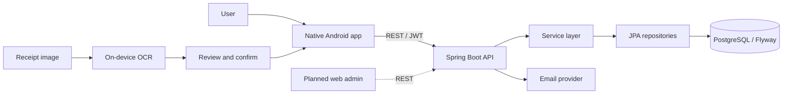

# Đồng — Personal Finance Manager

A mobile-first personal finance platform for managing everyday transactions, wallets and budgets, supported by a Java Spring Boot backend.

**Stack:** Android (Java/XML) · Spring Boot · Spring Security · PostgreSQL · Flyway · Docker

**Status:** Active development · Android and backend implementation · Web administration planned

## Overview

Đồng helps users understand where their money goes by bringing expense and income tracking, wallet balances, transfers and monthly budgeting into a single workflow. The project separates mobile presentation from backend financial rules and provides a foundation for secure, maintainable personal finance services.

The repository retains the historical FinTrack name in some packages and internal documents.

## Features and implementation status

| Capability | Current scope |
| --- | --- |
| Authentication | Backend registration, login, email verification, password management and rotating refresh tokens |
| Wallets and categories | Backend finance APIs and mobile wallet/category workflows |
| Transactions | Income, expense and wallet transfers; list, search, filters and transaction forms |
| Budgeting | Monthly budgets, category limits and spending progress |
| Home dashboard | Balance and transaction summaries derived from financial records |
| Notifications | Backend notification and settings endpoints |
| Receipt import | On-device OCR and explicit review/confirmation in Android |
| Web administration | Planned React client; repository currently contains a scaffold |

Android includes both mock and real API configurations. Implemented screens and backend endpoints do not by themselves establish complete end-to-end integration; see the [Android implementation progress](android/docs/frontend-ui/implementation-progress.md).

## System architecture



The Android client follows an MVVM-oriented structure. The backend uses a controller–service–repository architecture to separate transport, financial rules and persistence.

## Engineering highlights

- **Authentication and access control:** Spring Security, RS256 access tokens, rotating refresh tokens, resource ownership checks and documented authentication policies.
- **Financial consistency:** Income and expenses affect one wallet; transfers affect both wallets without inflating income or expense totals. Budget spending derives from expense transactions. The finance contract defines validation and calculation rules.
- **Privacy-conscious OCR:** Receipt images are processed on-device. Users review the extracted transaction information before submission; the OCR image is not uploaded by this workflow.
- **Schema management:** Flyway migrations are the deployable schema source. Environment-specific configuration separates development, staging and production.
- **CI and staging:** Backend and Android CI are configured. Staging deployment documentation covers HTTPS and isolated PostgreSQL, with a commit-SHA-based deployment workflow prepared for server configuration and rollback.

## Technology stack

| Component | Technologies |
| --- | --- |
| Android | Java, XML, Material Components, ViewModel, LiveData, Retrofit, OkHttp |
| Backend | Java 21, Spring Boot, Spring Security, Spring Data JPA, Bean Validation, Actuator |
| Database | PostgreSQL 17, Flyway |
| OCR | Google ML Kit Text Recognition |
| Testing | JUnit, MockMvc, Spring Security Test, Testcontainers; Android unit tests |
| Infrastructure | Docker Compose, GitHub Actions |
| Web admin (planned) | React |

## Getting started

Prerequisites: Docker Compose, JDK 21 for the backend, and Android Studio with the repository's configured Gradle JDK for mobile development.

```bash
git clone https://github.com/zaabinh/finance-manager-android.git
cd finance-manager-android
git checkout develop
cp .env.example .env
```

Fill in the required local database and authentication settings as described in the [environment guide](docs/development/LOCAL_ENVIRONMENT.md) and [backend README](backend/README.md). Do not commit secrets.

```bash
# Start the local PostgreSQL service
docker compose up -d --wait postgres

# Run the backend locally
cd backend
./mvnw spring-boot:run
```

Windows users can run `mvnw.cmd` instead of `./mvnw`. Alternatively, use `docker compose up -d --build backend` from the repository root.

- API: http://localhost:8080
- Swagger UI (development): http://localhost:8080/swagger-ui/index.html
- Health: http://localhost:8080/actuator/health

Open `android/` in Android Studio and follow its [setup guide](android/README.md) and [environment configuration](android/ENVIRONMENTS.md). The emulator can reach a host-local API at `http://10.0.2.2:8080/`. The mock flavor is useful for exploring UI without a live API.

The web admin is not yet a runnable React application; see its [scope](web-admin/README.md).

## Testing

```bash
# Backend, from backend/
./mvnw test
./mvnw -Ppostgres-it verify  # requires Docker

# Android, from android/
./gradlew :app:assembleDebug :app:testDebugUnitTest
```

The [CI guide](.github/workflows/README.md) documents the checks. Android instrumentation compilation and unit testing are not equivalent to verified device tests. The documented device run was interrupted; full device and backend integration verification remains pending.

## Repository layout

```text
android/          Native Android client
backend/          Spring Boot REST API and database migrations
web-admin/        Planned administration client scaffold
docs/             Product, API and engineering documentation
deploy/           Staging deployment assets
.github/          CI and staging deployment workflows
```

## Documentation

- [Product context](docs/product/PRODUCT_CONTEXT_VI.md)
- [API contract](docs/api/CONTRACT.md) and [finance CRUD contract](docs/api/FINANCE_CRUD_CONTRACT.md)
- [Authentication implementation](docs/api/AUTHENTICATION_IMPLEMENTATION.md)
- [Local environment setup](docs/development/LOCAL_ENVIRONMENT.md)
- [Staging deployment](docs/deployment/STAGING.md) and [CD design](docs/deployment/CD_STAGING.md)
- [Documentation index](docs/README.md)

## Roadmap

Complete real-environment Android/backend integration, verify device flows, improve receipt extraction and expand administration capabilities. Voice-based transaction entry and advanced AI-assisted receipt understanding are potential extensions, not current features. Production deployment and production CD are not claimed.
